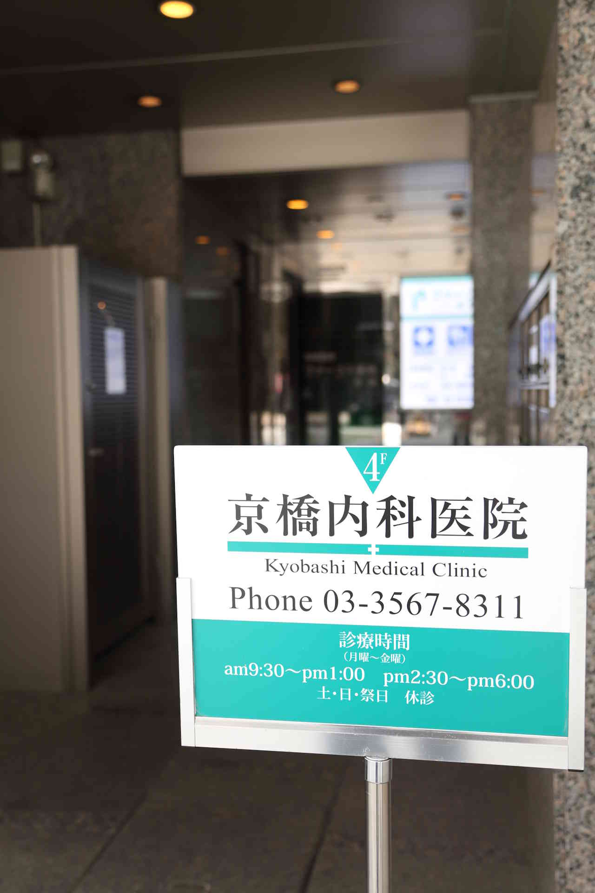
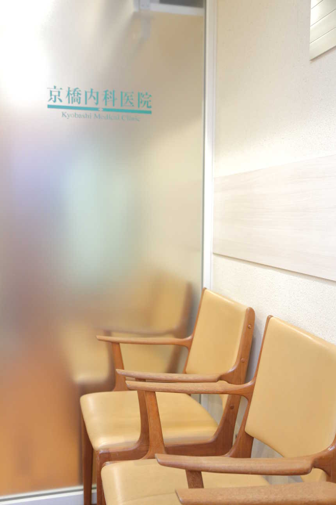
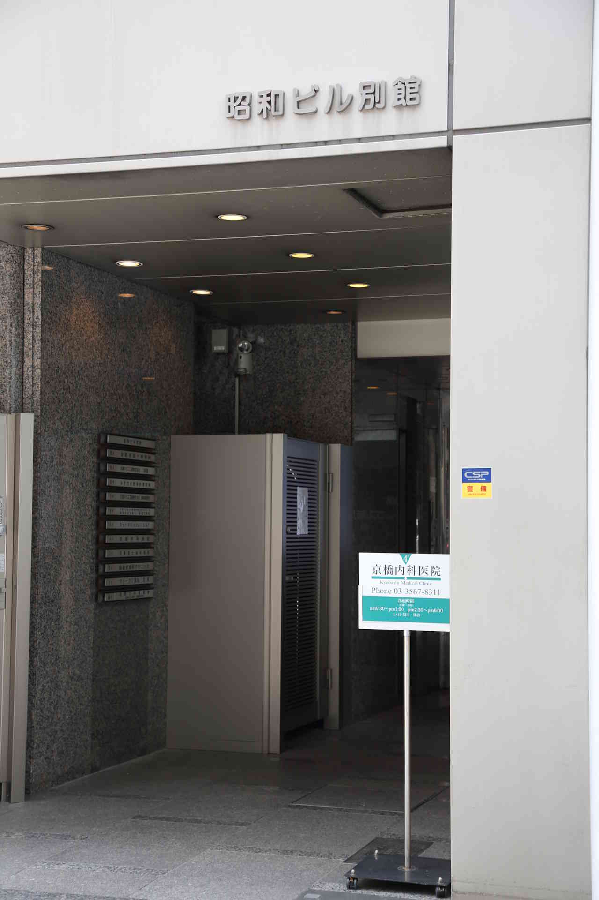
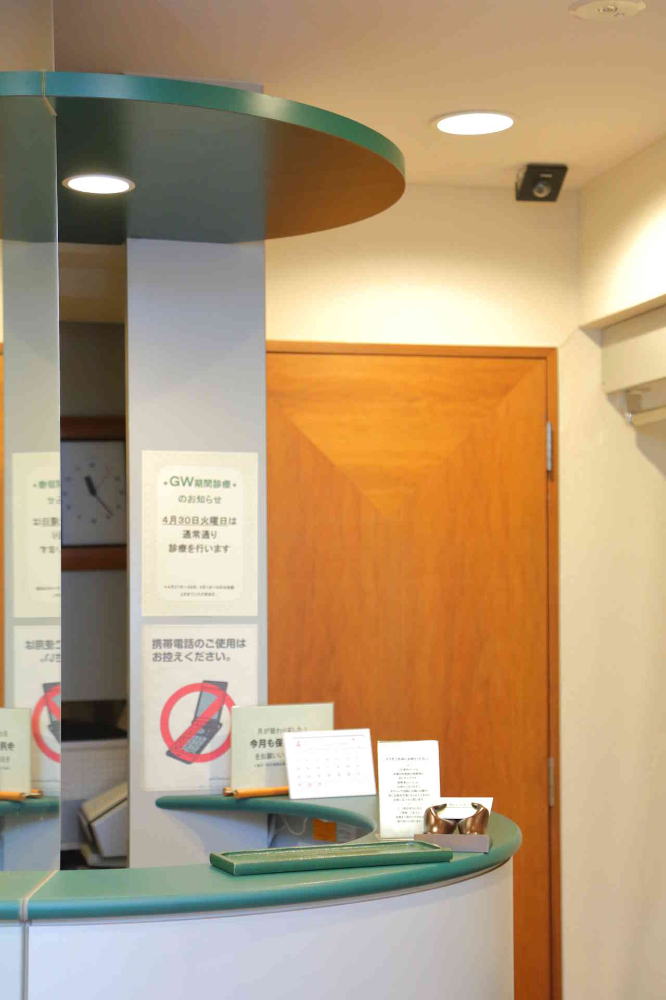
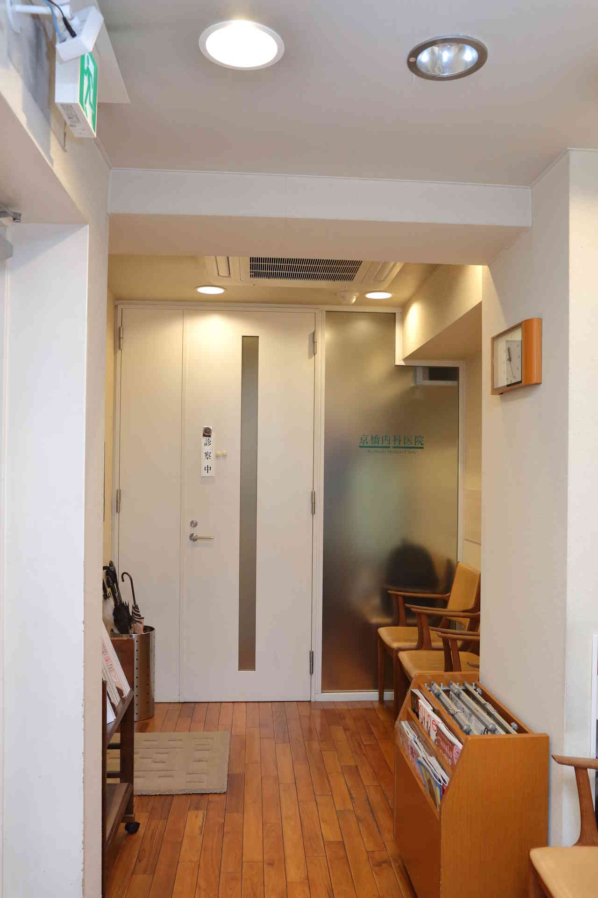
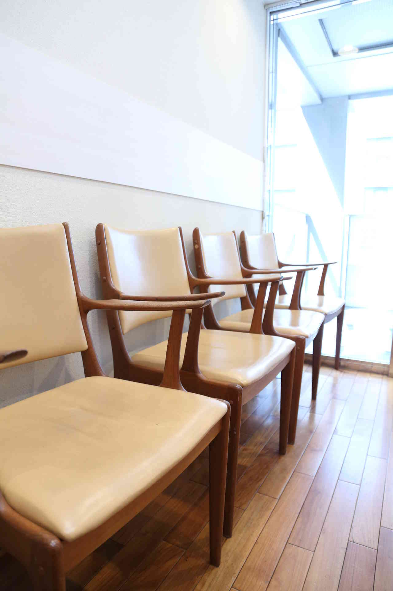
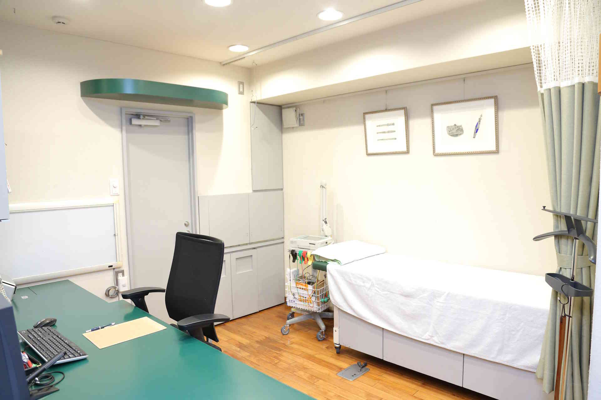

## 院長ご挨拶

人生100歳時代と言われる今の時代に、健康寿命を全うするための「人生の伴走者」として信頼される医師でありたい

近年「100年健康寿命」という言葉をよく聞くようになりました。

ただ、漫然と長生きするのではなく、いかに健康な生活を送られるか、いかに人生を元気で思う存分に謳歌できるかということに関心が集まってきています。そのためには、不意に起こる急性疾患は勿論のこと、知らず知らずの間に、あるいは年齢を重ねるにつれ発症してくる慢性疾患に、しっかり向き合ってゆくことが大切になってきます。

健康を守る第一歩は、皆様方の体についての気づきから始まります。体調不良や、ちょっとした違和感で気づく方も多いでしょう。健康診断や人間ドックで生活習慣病や検査値異常が見つかる場合もあります。自覚症状や検診結果は、海に浮かぶ小さなサインのようなものです。近くに陸地があるかもしれず、嵐の前触れかもしれません。水面下には大きな問題が隠れている可能性もあります。医師は海面下を少しのぞくことはできても、深海の底まで見通すことはできません。

医者は自覚症状という小さな異和を手がかりとして拝見し、病歴や診察所見と健診結果分を、合わせて問題点を整理します。過去に遡ってその由来を訪ね(既往歴や家族歴など)、病気の湧き出る泉を探し求め、食生活、薬剤服用歴、肥満や喫煙飲酒歴などの生活習慣、職歴などを考え併せて、今現在の病状に至った背景を分析し、説明しようと試みます。

私は一人一人の患者様に向き合い、一回一回の診察に全力を尽くすことをモットーにしています。

京橋内科医院院長

吉川正洋

## 診察とは皆さまと私との往復運動

診療するとは、現在の症状をどのように捉えて、どのように治療し健康を回復してゆくか、またその先の将来に、起こるかもしれない疾病をいかに予防し、健康百年人生を実現してゆくかを皆様と対話を繰り返していくことだと思います。次回の診察時には、治療効果や検査結果を拝見し、初診時の白紙の気持ちに立ち返って、対話しながら診断の流れを組み直し、速やかな回復を目指します。あわせて、今後いかにして未病を防いでゆくかについても分かりやすくご説明していきたいと思います。皆様と私との長く続く往復運動であり、あるいは二人三脚のお付き合いになるかもしれません。

### 略歴

東京都出身。金融機関、化学メーカーで勤務後、医学部学士入学。

卒業後、国立病院勤務を経て、1996年に京橋内科医院を開設。

### 資格

・日本内科学会認定医・身体障害者認定医(呼吸器)・日本医師会認定産業医

## 医院紹介

<figure>

<figcaption>外観：昭和ビル別館4階に位置しております</figcaption>

</figure>

<figure>

<figcaption>玄関：ビル1階にある看板が目印です</figcaption>

</figure>

<figure>

<figcaption>受付：来院時はまずこちらにお越し下さい</figcaption>

</figure>

<figure>

<figcaption>待合風景１：木目が特徴の落ち着いた空間です</figcaption>

</figure>

<figure>

<figcaption>待合風景２：診察までゆっくりお待ちいただけます</figcaption>

</figure>

<figure>

<figcaption>診察室：清潔で開放感のある空間です</figcaption>

</figure>

## 提携医院紹介

高度の医療や、救急での対応が必要な時には、以下の大学病院や、専門病院と連携・提携契約をしていますので、迅速に受診、入院の対応をいたします。紹介状ならびに治療内容・レントゲン・心電図や検査成績などの資料を準備いたします。

### 千代田区

・三井記念病院・日本大学病院・佐々木研究所付属杏雲堂病院

### 港区

・東京慈恵会医科大学付属病院・NTT東日本関東病院・東京都済生会中央病院・東京高輪病院（JCHO）・心臓血管研究所付属病院

### 中央区

・聖路加国際病院・朝日生命成人病研究所附属医院

### 文京区

・順天堂大学医学部付属病院順天堂医院・東京大学医学部付属病医院・日本医科大学付属病院

### 渋谷区

・日本赤十字社医療センター・JR東京総合病院

### 新宿区

・東京医科大学病院・国立国際医療研究センター病院・東京山手メディカルセンター（JCHO）

### 江東区

・昭和医科大学江東豊洲病院

### 品川区

・昭和医科大学病院

### 大田区

・東京都立荏原病院・東邦大学医療センター大森病院

### 豊島区

・都立大塚病院

### 他

・国立精神・神経医療研究センター病院

上記に記載以外の医療機関以外での受診を希望される場合にも、同様に、紹介状などを各種取り揃えるとともに、受診の手配をいたします。お気軽にご相談ください。
