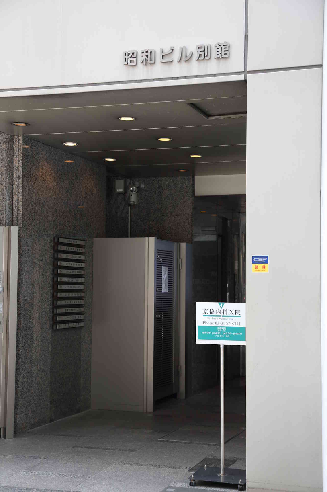
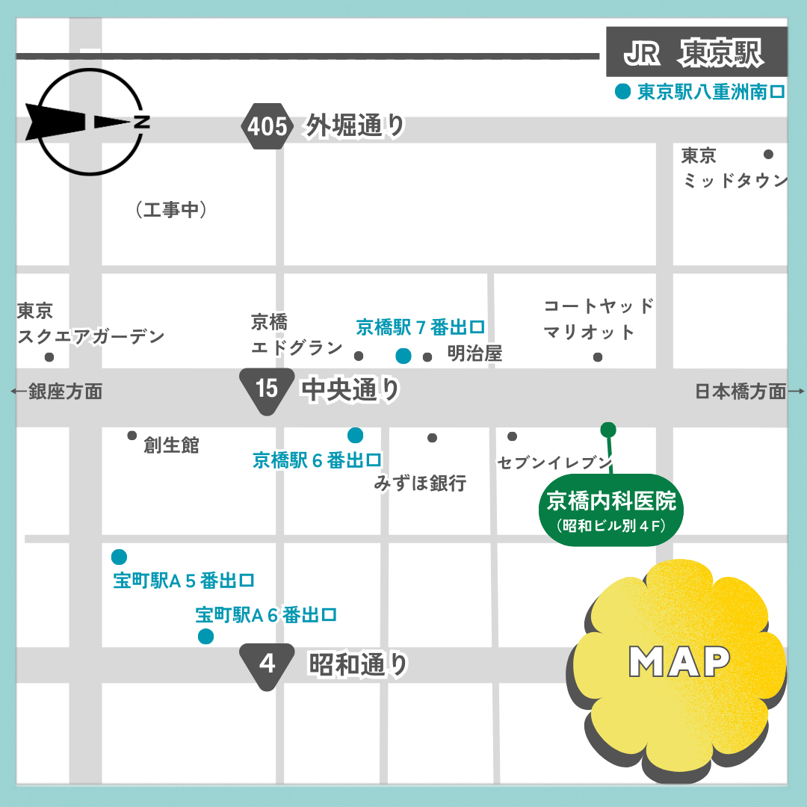

## アクセス

〒104-0031東京都中央区京橋2－8－21昭和別館ビル４F

<nav class="map-service-links" aria-label="地図サービス">
  <a href="https://maps.app.goo.gl/NF3RKk3aTCTMRBB19">Google Maps はこちら ＞</a>
  <a href="https://maps.apple.com/?q=東京都中央区京橋2-8-21">Apple Maps はこちら ＞</a>
  <a href="https://map.yahoo.co.jp/search?lat=35.6774856&lon=139.7709429&q=東京都中央区京橋2-8-21">Yahoo!マップ はこちら ＞</a>
</nav>

## 病院までの道のり

『セブンイレブン』の２つ先のビルの４階（１階は薬局）。

『明治屋本店』は中央通りを挟んで斜め向かい側です。

### 東京メトロ

銀座線京橋駅下車し、６番出口から中央通りを北方向に徒歩100メートルほど

### JR（東京駅）

東京駅八重洲南口から東京ミッドタウンを左側に見て中央通りに出ますと、通りの向う右手に見えます。

### 都営地下鉄

都営地下鉄浅草線・宝町下車。Ａ５番、Ａ６番またはＡ７番出口から昭和通りに出ます。そのまま北方向に向かい、歩道橋の手前を左折。中央通りに出ましたら右折して３軒目のビルの４階です。
