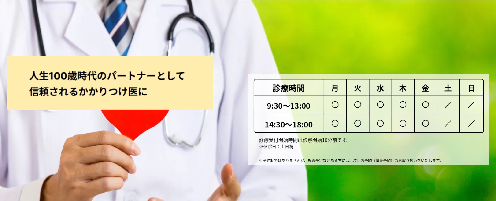

## お知らせ

2026年9月14日より、インフルエンザワクチンの接種を開始いたします。  
ご予約は不要です。随時お越しください。

---

## 健診後フォロー専用枠のご案内

京橋内科医院からのお知らせです。

“経過観察”　”要再検査”——  
それは”異常なし”とは違います。

気になっているなら、それがサインです。  
忙しくて、後回しにしていませんでしたか。

“生活習慣に気をつけてください”  
“しばらく様子を見てください”——  
でも、具体的に何をすればいいか、教えてもらえましたか。

数値だけでなく、生活歴の背景から診察します。  
初めての方も、どうぞお気軽にお越しください。

**■ ご相談いただける主な症状・疾患**

コレステロール高値 ／ 血糖値・血糖検査の異常 ／ 血圧 ／ 体重過多・肥満 ／ 心電図異常 ／ 睡眠時無呼吸症候群（いびき）／ 腎機能 ／ 尿酸値 ／ 肝機能 ／ 甲状腺・ホルモン異常

---

迷わず、お越しください。  
なるべく早く、しかもじっくり話したい——  
健診後フォロー専用枠を、別途ご用意しております。  
結果票一枚でお越しください。

**【ご予約・ご相談】健診後フォロー専用枠（月曜〜金曜 15:30〜）**

[TEL：03-3567-8311](tel:0335678311)  
月曜〜金曜　9:30〜13:00 / 14:30〜18:30

当日12時までのお電話で、その日の専用枠をご確保できます。  
結果票をお持ちでない方、見方がわからない方もそのままどうぞ。

症状が軽いうちに、早めの受診がおすすめです。

---

皆さまのご来院を、スタッフ一同心よりお待ちしております。

京橋内科医院  
〒104-0031 東京都中央区京橋2丁目8番21号  
TEL：03-3567-8311  
月曜〜金曜　9:30〜13:00 / 14:30〜18:30

---

## 診療案内

体にちょっとした違和感や、なんらかの異常な症状を感じた時には、ご遠慮なくお尋ねください。

発熱や痛み、あるいは胸部、腹部、頭部、首まわり、手足などのお困りの症状をうかがい、急性・慢性や重症度を考え、自覚症状の無い他部位の所見とあわせて、全身の健康状態を総合的に拝見いたします。必要に応じて、大病院、専門医などとも連携して診察・診察にあたります。

今ある疾患を治療するだけにとどまらず、将来の健康人生を視野に入れて現在を見直し、予防医療、あるいは未病を防ぐように心がけております。

---

## 医院案内

**「一生の健康」をサポートする医院です。**

当院は形だけの診察をし、処方箋をお出しするだけの医院とはいささか趣を異にするようにしています。お忙しい中、貴重な時間を使って来院していただいた患者様の健康寿命の最大化をめざし、丁寧にヒアリングと診察を行い、疾患のおおもとに立ち返って解決につながるように心がけています。

どのような、ささいな気付き、気になることでもかまいませんので、ぜひお気軽にご相談ください。