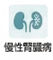
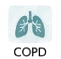
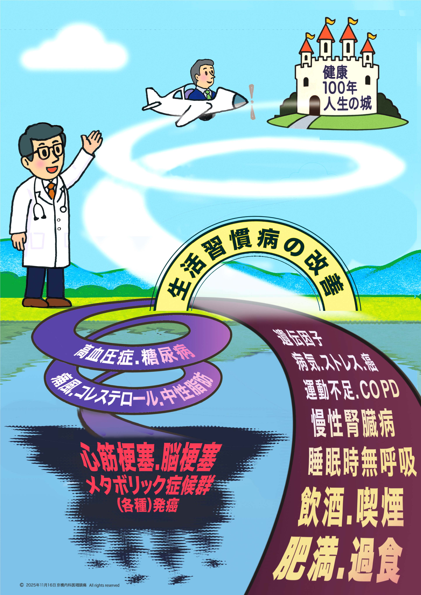
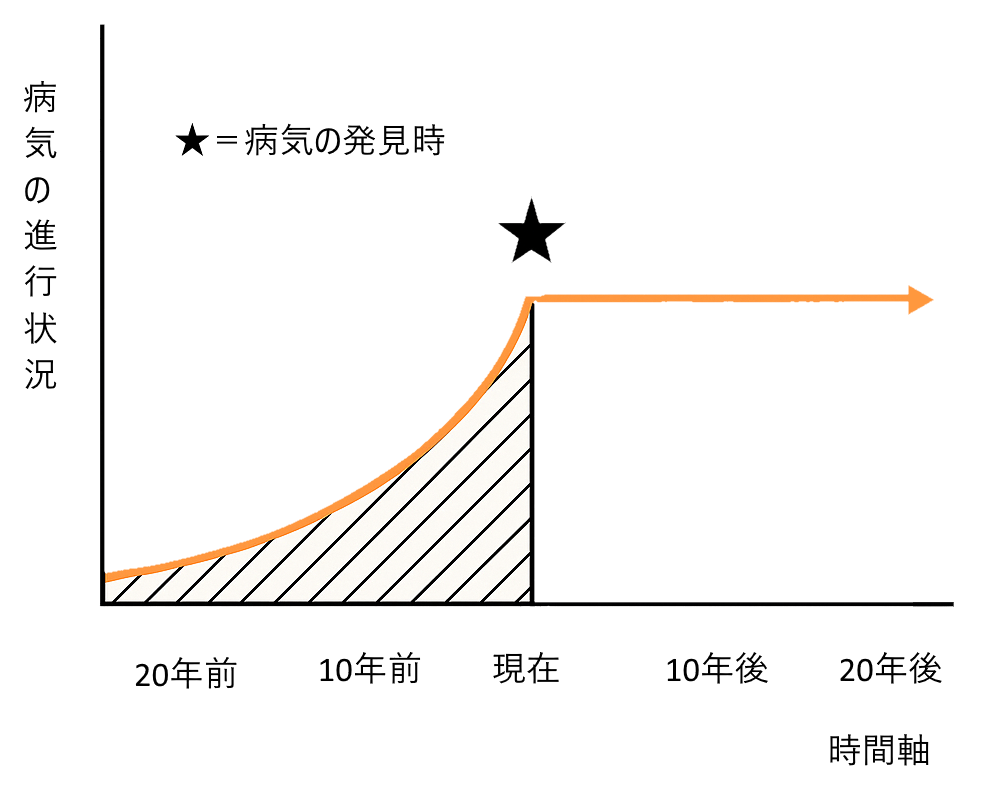

## 診療案内

体になんらかの異常や症状、あるいは違和感を感じた時には、ご遠慮なくご相談ください。

発熱や痛み、あるいは胸部、腹部、背部、頭部、首まわり、四肢などのお困りの症状をうかがい、急性・慢性や重症度を考え、自覚症状のない他部位の所見とあわせて、全身の健康状態を複合的に診察いたします。必要に応じて、大病院、専門医などとも連携していきます。

今ある疾患を治療するだけにとどまらず、将来の健康人生を視野に入れて現在を見直し、予防医療、あるいは未病を防ぐように心がけております。

## 一般内科

### 主な診療内容

発熱、咽頭痛、咳、たん、全身倦怠息苦しさ、胸痛、動悸、不整脈、むくみ食欲不振、体重減少下痢、腹痛、嘔吐、むねやけ・げっぷ、便秘、血便頭痛、めまい、しびれ、筋力低下花粉症、アレルギー性鼻炎、蕁麻疹不眠、いびき(睡眠時無呼吸症候群)、昼間の眠気・倦怠感高血圧症、動脈硬化、心不全、脂質異常症（コレステロール・中性脂肪）、糖尿病、メタボリック症候群

これらの症状を手掛かりにして、全身の症状をみて、複合的に考え併せてゆきます。

発熱、咳、頭痛、倦怠感などの感冒様症状から、胸部・腹部・頭頸部の異常、さらには全身症状、慢性疾患や生活習慣病にいたるまでを系統的に診察し、原因を明らかにしながら治療・予防へとつなげてゆきます。高血圧症や脂質異常症、糖尿病などの生活習慣病を視野にいれた診療を行っています。健康診断や人間ドックで異常を指摘された際にも、どうぞご相談ください。

## 生活習慣病

生活習慣病でお悩みの方健康診断で「要再検査」と診断された方へ

「生活習慣病」とは、肥満や食習慣、運動習慣、喫煙、飲酒などの生活習慣の積み重ねに、年齢も加わり発症・進行する疾患です。その中には、高血圧症、脂質異常症、糖尿病、慢性腎臓病などに加えて、睡眠時無呼吸症候群、循環器疾患、慢性気管支炎、慢性肝炎、肝硬変、痛風、大腸がんはじめ各種がん、歯周病などが含まれます。さらには成長歴や遺伝歴なども関与します。生活習慣病とは、生活習慣を改めることにより、発症を遅らせ、あるいは治療、予防することも可能な疾患と言えます。

### 食習慣に関連する疾患

糖尿病、肥満症、高脂血症、高血圧症、高尿酸血・痛風、循環器疾患、大腸がん

### 運動習慣に関連する疾患

糖尿病、肥満症、高脂血症

### 喫煙に関連する疾患

肺がん、循環器疾患（狭心症や心筋梗塞、不整脈）、慢性気管支炎、肺気腫

### 飲酒に関連する疾患

慢性肝炎、肝硬変、肝がん

<figure class="lifestyle-diagram">

</figure>

### 当院での対応

生活習慣病の予防・改善のために、もっとも大事なのは、早期受診により根本的な原因をできるだけ早く特定することです。

多くの場合、40代から50代にさしかかると生活習慣病の前段階として、肥満、いびき(睡眠時無呼吸）、脂質異常、高血圧、高血糖、慢性腎臓病といった症状が顕著に現れます。こういった症状は、1回きりの通院で改善するのは困難です。

定期的に病院に足を運ぶことは面倒と感じる気持ちは理解できますが、健康はなににも変えられません。

数年後、「あのときに相談していれば・・」と後悔しないよう、少しでも気になる症状がある方や、健康診断で「要再検査」の結果がでた方は、当院の受診をご検討ください。

<figure class="timeline-diagram">

<figcaption>斜線部分の時期：治療すべき時期★以降の時期：治療により進行を遅らせることができる時期</figcaption>

</figure>

## 「なんとなく体調が悪い」とお悩みの方へ

生活習慣の乱れ、心身のストレス、ホルモンバランスなど、複数の要因が原因となり症状につながっているケースが少なくありません。また症状の重さや時期にもばらつきがあるため、他院では明確な診断や解決策を提示できない事例がみられるようです。当院では、これまで「特に問題はないしばらく様子を見ましょう」、または「原因はわからないといわれた」とされていた患者様が、何らかの機会に受診いただいた結果、新たな発見や改善につながったこともあります。早期に受診することで、さまざまな疾患の早期発見と進行防止が期待できますので、一度当院までご相談ください。

## 予防接種

各種ワクチン、予防接種を行っております。

インフルエンザワクチン、肺炎球菌ワクチン、風疹ワクチン、はしかワクチン、流行性耳下腺炎(おたふく)ワクチン、A型・B型肝炎ワクチン
